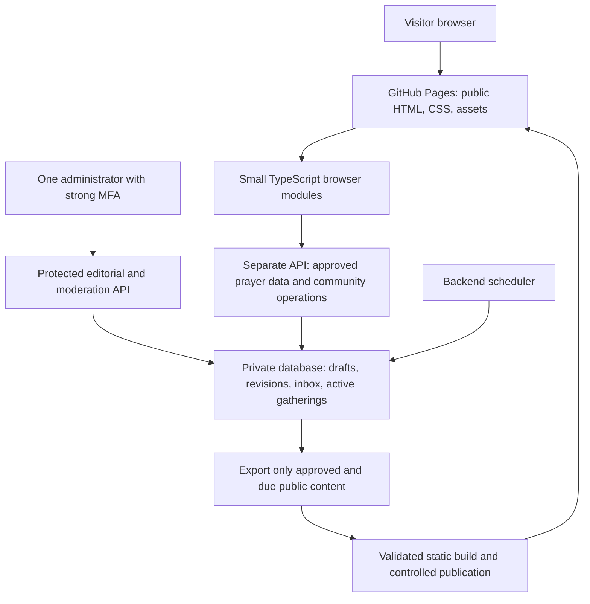

# Nur und Huda — proposed architecture

Date: 2026-10-29. Decision status: **proposed for review, not implemented**.
Scope: `nurundhuda-hub/nur-und-huda`; working branch `codex/audit-and-rebuild` only.
Budget target: €0–10/month. No paid service, account creation, merge, or deployment is authorized by this document.

## Recommendation and tradeoffs

Use **Astro in static-output mode, TypeScript for behavior and data contracts, ordinary CSS, and small browser modules**. Keep GitHub Pages for public HTML/assets. Add a separate managed backend only for shared writes, private editorial work, scheduled publication, and moderation. Start with no React runtime on public reading pages.

| Option | Benefits | Costs / limits | Decision |
| --- | --- | --- | --- |
| Existing HTML/CSS + modular JS | Smallest migration; no dependencies required; sufficient for the first visual pass | Repeated layouts and content validation become manual as sermons, studies, and translations grow | Valid fallback if maintaining a build tool is undesirable; fix the existing code rather than rewrite merely for fashion. |
| Astro static output + TypeScript | Shared layouts, generated content pages, typed data, limited client JS, natural direct URLs | Requires Node/build maintenance and a lockfile | Recommended for the full content site. Adopt during the visual phase only after review. |
| React + TypeScript + Vite SPA | Familiar reusable interactive UI; useful for a substantial editor/admin application | Browser JS for basic reading, route-fallback handling on Pages, extra state/runtime dependencies; still needs a backend | Not justified across the whole public site. Reconsider an isolated admin bundle or complex community component when actual complexity warrants it. |

TypeScript is justified by date/time handling, publication states, and API contracts. Vite is a build tool rather than a backend or a requirement to use React; Astro already uses a build pipeline. Astro can ship static HTML and hydrate only selected components. [Astro islands architecture](https://docs.astro.build/en/concepts/islands/)

For a visual-only milestone, no backend or framework migration is intrinsically necessary. If Astro is chosen, migrate the six existing routes together, retain their URLs, and avoid creating a second competing public app.

## System boundaries



The diagram describes the eventual system, not permission to deploy. Pages is a static host: it cannot safely store private records or execute server-side authentication/jobs. Public HTML remains readable when the API fails. [GitHub Pages architecture](https://docs.github.com/en/pages/getting-started-with-github-pages/what-is-github-pages)

Keep code, migrations, tests, and public content contracts in this repository. Do not create or access another project/repository. Private runtime data lives in the approved backend, never in a public Git branch, workflow log, static bundle, or source map.

## Proposed repository organization

```text
src/
  layouts/                  Arabic-first shared layout; language/direction support
  components/               Header, footer, prayer card, cards, notices
  pages/                    Homepage and preserved .html routes; later detail routes
  content/                  Only content approved for public repository visibility
  scripts/                  Prayer clock, search, disclosure, reading preferences
  styles/                   Tokens, Arabic typography, responsive and print CSS
  lib/                      Schemas, source adapters, timezone and publication logic
public/
  assets/logo.jpeg          Byte-identical copy at the same public URL
  fonts/                    Approved local files and applicable license notices
backend/
  migrations/               Database schema, access policies, retention jobs
  functions/                API validation, moderation, publishing, source adapters
tests/                      Behavior, content-integrity and authorization checks
docs/                       Source register and operational decisions as needed
.github/workflows/          Initially validation only; release workflow later
```

This is a target layout, not a request to move files now. Preserve the original root `assets/logo.jpeg` during migration and compare the served copy's hash. Avoid asset conversion, recoloring, or cropping without a separate approved design decision.

## Public frontend

- Exact tokens: `#073D30`, `#0E5140`, `#C9A45C`, `#E4C783`, `#F8F3E6`. No red decorative text or headings, including intrinsic font palettes. The approved tagline remains **منبر للذكر .. ومرجع للعلم النافع**.
- Use a licensed monochrome Ruqaa-style heading face and readable Naskh body face, self-hosted after license verification. Keep source/license files. Decorative CSS geometry should be subtle and hidden from assistive technology.
- Default Arabic RTL; use logical CSS properties and isolate mixed-direction numbers/URLs. Localize labels separately from content. Future German routes use `lang="de" dir="ltr"`; do not machine-publish translations of religious material without review.
- Shared navigation includes Quran and all public modules. Legal links are consistently accessible. Keep hospital identification out of prominent homepage branding; use `St. Barbara-Klinik Hamm-Heessen` only where needed and verified.
- Generate real files for current `.html` URLs and future detail URLs. Configure deployment base `/nur-und-huda/` for the default project URL; a custom domain needs an explicit different configuration. Verify refresh/deep links under the actual base, including asset URLs, API-independent fallbacks, and later service-worker scope. No SPA catch-all redirect hack. [Astro GitHub Pages configuration](https://docs.astro.build/en/guides/deploy/github/)
- Static content and navigation must work without JavaScript. Live features should show a clear unavailable state when JS/API/network is unavailable.

## Prayer-time source and calculation policy

**Task 09 approved decision:** a verified local mosque timetable is the primary source, provisionally As-Salam Moschee Hamm. Adhan is comparison/diagnostics only. The importer and evidence gaps are documented in [LOCAL_TIMETABLE_REVIEW.md](LOCAL_TIMETABLE_REVIEW.md); no authorized local export has been received and production remains inactive.

### Approved provider boundary

Define a source-neutral daily record: Berlin local date, IANA timezone, verified location/configuration version, five prayer timestamps, source identifier, retrieval/approval timestamps, validity interval, and provenance. Separate prayer-start time, congregation iqama, and Friday sermon/iqama fields. A proposed community meeting time must never overwrite prayer times.

Mawaqit states that its API is private and offers a mosque-specific URL or widget through support. The operator must identify the correct prayer-room/mosque record and obtain applicable integration terms. No record, permission, or API credential is established by this audit. [Official Mawaqit guidance](https://help.mawaqit.net/en/articles/11991838-can-i-use-your-api)

An official iframe is a possible integration but adds third-party requests, accessibility/theming constraints, and a cross-origin boundary. Do not read its DOM or scrape its page to populate a custom countdown. Use a link, or a clearly explained click-to-load embed if privacy review supports it. A custom countdown requires an approved, authorized machine-readable local timetable. Keep any provider secret exclusively server-side, with caching only as permitted.

### Independent calculation diagnostics

Use a reviewed, licensed astronomical implementation operating on a fixed, verified prayer-room location. Version its inputs and compare output against approved local timetables. Do not use visitor geolocation, browser timezone, guessed coordinates, or a library's default method as religious authorization.

Record the diagnostic settings for Fajr/Isha twilight angles or alternative rules, high-latitude summer treatment, Asr convention, elevation/sunset assumptions, rounding, and any local offsets. High-latitude twilight requires explicit consideration; choosing among conventions is not a software-only decision. Calculated results are not eligible for public activation under the Task 09 decision. [International Astronomical Center discussion](https://astronomycenter.net/latitude.html?l=en), [Pray Times calculation configuration](https://praytimes.org/manual)

Validate a full seasonal sample including midsummer, winter, both Berlin DST transitions, midnight/year rollover, and every date in the locally approved Ramadan period. Check Maghrib against the approved local sunset/timetable and resolve discrepancies before enabling an iftar countdown. No hardcoded generic Ramadan adjustment, automatic selection of an arbitrary method, or fabricated times. Task 08 selected pinned Adhan 4.4.6 (MIT) for these diagnostics; Task 09 retains it solely for that purpose.

Fallback order: current approved and authorized local timetable → still-valid approved copy of that same source, within permission scope → unavailable. No calculated fallback. Never silently show yesterday's data or substitute a different city's timetable. Hospital Friday sermon and iqama times require independent administrator approval; they are neither mosque Friday fields nor astronomical calculations.

### Clock behavior

Store instants in UTC and retain the Berlin local date/timezone context. Select the next prayer from actual timestamps, including next-day Fajr after Isha. Derive remaining time from the current clock on each update; do not decrement an accumulating counter. Refresh after sleep, visibility changes, date rollover, and network recovery. Handle wrong device clocks explicitly where a trusted server-time comparison is available. Do not announce every ticking second to screen readers; announce only meaningful state changes. Disambiguate DST local times when accepting administrator/gathering input.

## Backend and budget decision

**Preferred candidate for the later prototype:** Supabase Free with a specifically selected EU database region, Postgres, Auth, server functions, and scheduled database maintenance. It reduces custom authentication/database operations and provides an exportable PostgreSQL model. This is conditional on a privacy/operations review, not a guarantee of production suitability.

The currently documented Free plan includes a 500 MB database and 5 GB egress and can pause after one week of inactivity. Pro starts at US$25/month and is outside this project's intended budget envelope; do not activate it. [Supabase pricing](https://supabase.com/pricing)

Select an exact EU location such as Frankfurt if available, not a generic “Europe” label. Region selection alone does not establish GDPR compliance: assess function execution locations, logs, support access, subprocessors, transfers, and processor terms. [Supabase regions](https://supabase.com/docs/guides/platform/regions)

| Component | Planned spend | Constraint |
| --- | --- | --- |
| Public Pages hosting | €0 if repository/account eligibility is confirmed | Use current account; no plan upgrade. |
| Static build and tests | Target €0 within included quotas | Verify visibility/runner eligibility and quotas before enabling. |
| Backend pilot | €0 on selected Free plan | Monitor database, bandwidth, job failures, inactivity and usage; no auto-upgrade. |
| Fonts and public source links | €0 | Use only verified free licenses/permissions. |
| Domain | €0 new spend in this plan | Existing/default Pages URL; renewal cost unknown. |
| SMS, paid email, paid CMS, paid monitoring | Not selected | Require a separate costed decision. |
| Remaining monthly allowance | Up to €10, uncommitted | Not authorization to purchase services. |

**Production gate:** free-tier pausing and scheduler availability may conflict with prompt deletion and reliable community service. A paid upgrade is not an assumed solution. If the candidate cannot meet the agreed retention/reliability criteria, keep community writes disabled and return a separately costed EU-hosted lightweight backend option for approval within €10 including tax/backups. Do not keep a free service awake artificially or claim an availability guarantee. The static site and approved sermons must remain useful without it.

Back up private editorial material encrypted off-site with a named operator and a restore test. Free-tier database exports need an explicit procedure; provider automatic backups cannot be assumed. Exclude ephemeral community data from application backups where possible, and document provider-level retention separately. [Supabase backup guidance](https://supabase.com/docs/guides/platform/backups)

## Community prayers: minimum data and API

Proposed records:

| Record | Minimum fields | Exposure |
| --- | --- | --- |
| Gathering | Random ID, nickname, prayer enum, proposed instant, short plain-text message, creation/expiry instants, moderation state | Public while active, excluding private control fields |
| Join intent | Gathering ID, hash of a random per-gathering browser capability, expiry | Private; used only for idempotency and undo, not attendance |
| Deletion capability | Hash of an unguessable creator token and expiry | Server-only hash; token returned once to creator |
| Abuse control | Short-lived throttling counters; minimal report reason | Restricted; avoid raw request/message logs |

Allow multiple gatherings for the same prayer. Never add a uniqueness constraint on prayer/date that prevents this. Join means intent, not verified attendance; do not expose participant lists, rankings, streaks, completion history, or employment/health details. A temporary aggregate intent count is optional, not a requirement for participation.

Suggested API surface: list active gatherings, create, join/undo, creator delete, report, administrator hide/delete. Use an idempotency key for retries and a unique per-gathering capability hash for join deduplication. No account, email, or persistent cross-gathering identity is required. Browser-scoped capabilities cannot prevent a determined user from resetting their browser; document that limit instead of fingerprinting people.

All writes pass server-side validation and bounded payloads. Start with proposed limits of 40 characters for nickname and 280 for message, a maximum 24-hour scheduling horizon, and configurable conservative rate limits. These are product defaults for review, not legal requirements. Plain text only; reject executable markup and unsafe URLs. Add a honeypot, transaction-safe throttling, server time checks, and restricted administrator moderation. Shared hospital networks require limits that do not indiscriminately block colleagues behind one IP. Escalate to a privacy-reviewed challenge only if actual abuse warrants it.

**Retention proposal:** expire at proposed start plus 60 minutes; active-list reads and writes exclude expired records immediately using server time. A job physically deletes gatherings and dependent capabilities within 15 minutes of expiry, with retries and operator-visible failure status. These intervals require operator approval. Soft deletion alone is not completion. Do not cache community responses in a service worker or archive them in Git. On recovery from an outage, purge overdue records before serving writes. Test the actual provider's ability to meet the deletion deadline; if it cannot, this launch gate fails.

For abuse metadata, propose deletion within 24 hours and rotating keyed IP-derived counters where necessary; hashes remain potentially personal data. Document logs, backup windows, consent/rights withdrawal, and reporting separately. The controller must assess an Article 6 basis and any required Article 9 condition before exposing prayer-associated personal data; a nickname is not proof of anonymity. [EDPB sensitive-data guidance](https://www.edpb.europa.eu/sme/be-compliant/process-personal-data-lawfully_de)

Optional push comes later: explicit action before permission prompt, minimal subscriptions, unsubscribe/delete path, generic notification text, and expiry tied to the relevant gathering. Notifications are best-effort and cannot be the sole source for prayer timing. Do not use SMS or email notification services by default.

## Administration and publishing

Provision one administrator; disable public registration. Require a supported passkey flow with recovery, or a unique strong password plus authenticator-app MFA. For the initial backend candidate, password + TOTP with server/database enforcement of `aal2` is a concrete baseline; a client-side login gate alone is insufficient. Protect the hosting/provider accounts with strong MFA too. [Supabase MFA enforcement](https://supabase.com/docs/guides/auth/auth-mfa)

The browser may contain the provider's intentionally public project identifier/publishable key where applicable, but never service-role credentials or GitHub publication tokens. Enforce a fixed admin identity and MFA claims on every privileged endpoint and database policy. Disable direct anonymous table writes; apply narrow backend operations with explicit checks. CORS origin allowlists reduce browser exposure but are not authentication. Validate CSRF protections if cookies are used, session expiry/revocation, recovery, and direct-API bypass attempts.

Use a structured rich-text editor with a small node/format allowlist, safe URL protocols, Arabic direction, and accessible controls. Store structured content and sanitize rendered HTML server-side and at publication. No arbitrary embedded HTML/scripts, executable MDX, or third-party media by default. Select an editor after an Arabic keyboard/RTL/license spike; no paid editor is assumed.

Publication model:

1. AI-assisted drafting happens outside the site. Private drafts and source notes enter the admin system.
2. A human verifies quotations, evidence, the exact edition/pages of **ما لا يسع المسلم جهله**, the two sermon parts, and the extended study.
3. Approval records an immutable revision/hash, approver, and timestamp. Subsequent edits invalidate approval. A single administrator can perform an explicit review step; no fictional second reviewer is implied.
4. The public eight-week schedule contains only approved metadata; missing topics remain clearly unscheduled. Approved full text is scheduled approximately seven days before its Friday, using Berlin dates.
5. A backend job selects only approved revisions whose publication instant has arrived and triggers a controlled static build. The build validates again and exports only due/public records. Secrets remain in server/build secret storage; the public branch never contains private or embargoed drafts.
6. Show scheduled, publishing, and live states separately to the administrator. Record successful public publication and retry failed builds; never mark content live merely because a job ran. Rollback uses the last approved revision.

GitHub scheduled workflows may be delayed/dropped and can disable after 60 days of repository inactivity. Do not use them as a precise release clock or community-deletion mechanism. Use backend scheduling with retries plus a manual release fallback; agree a publication window (proposed: within one hour after the approved target) rather than promising exact timing. [GitHub scheduling behavior](https://docs.github.com/en/actions/reference/workflows-and-actions/events-that-trigger-workflows#schedule)

Each published sermon has separate part-one/part-two content, approved metadata, an actual **اقرأ الموضوع كاملاً** link beneath it, and a referenced extended study. Verify approximate ten-minute reading time through a human rehearsal. Imam mode uses large adjustable Naskh text, minimal controls, clear contrast, and a dedicated print layout. Provide an explicitly saved, version-labelled offline copy of approved content; later cache only public approved editions. Show revision/update status when online again and explain that an already downloaded copy cannot be recalled remotely.

Announcements use the same approval/version rules. A contact form, when enabled, writes to a private admin inbox with rate limits and an approved retention period (proposed: 30 days after resolution); it must not solicit patient or employment details. Existing email contact remains a separate, verified operator decision, not a substitute for the eventual inbox requirement.

## Quran, library, and rights register

Initially use official outbound links. King Fahd is the preferred Quran source; its linked rights notice concerns a specific Illustrator edition. Verify the exact asset/version and permitted web use, attribution, modification and redistribution conditions before downloading or embedding text, fonts, pages, or audio. [King Fahd edition rights](https://dm.qurancomplex.gov.sa/rights/)

For any approved Quran asset, record checksum/source version; preserve the canonical text/diacritics exactly. Do not normalize, retype, regenerate, or silently correct it. Keep search indexing transformations separate from canonical display and verify rendering with a qualified human reviewer. Attribution is necessary but not proof of permission.

Library records contain verified title, original short description, language, subject tags, source, exact reading URL, and review date. Link to Arabic/German Risala originals; do not mirror books or assume the named primary reference is available at a generic directory link. Local search may normalize titles/tags for discovery; it must not modify source text.

Maintain a source register for King Fahd, Risala Al-Haramain, Mawaqit, fonts, and code dependencies: asset ID/version, canonical URL, license/permission evidence and date, allowed uses, required attribution, reviewer, and unresolved restrictions. Publish accurate entries in Quellen & Lizenzen. Never infer redistribution rights from free access or non-commercial intent.

## Security, privacy, and operations

Serve no analytics or remote fonts by default. Inventory unavoidable hosting/API logs; document the controller, processors, lawful bases, transfers, retention, rights contact, and any optional storage/notification consent. Keep legal pages German-accessible with Arabic explanation where useful. Legal identity and publication approval are operator decisions.

For Pages, use a restrictive tested CSP meta policy where feasible; do not assume it can enforce header-only directives such as `frame-ancestors`. Configure full security headers on the backend host. Never claim arbitrary Pages response headers from a repository `_headers` file. Keep approved third-party origins minimal and review any iframe policy separately.

Use a pinned runtime/lockfile, reviewed dependency updates, least-privilege CI permissions, and separate PR validation from production publishing. No deploy job should run from the audit branch. Later release changes require reviewed code, content checks, base-path smoke tests, and a documented rollback to a known good artifact. Monitor operational failures without visitor tracking.

Open decisions before activation: legal operator/contact details; exact prayer-room location and authorized source; Fajr/Isha/high-latitude/Ramadan profile; verified content/asset permissions; backend processing/retention terms and reliability; admin recovery; accepted publication window; optional domain and paid-service decisions. These do not prevent reviewing or building the approved visual shell.
